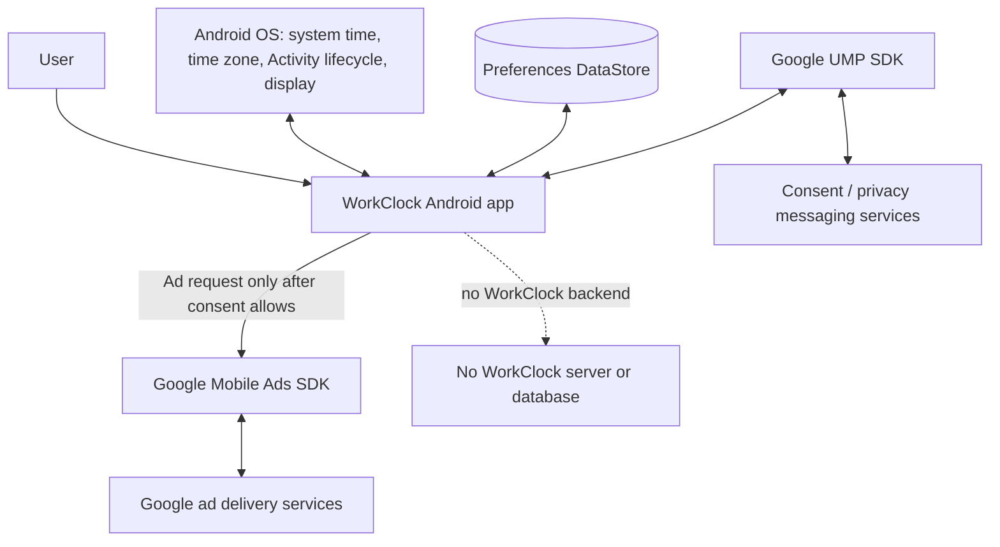
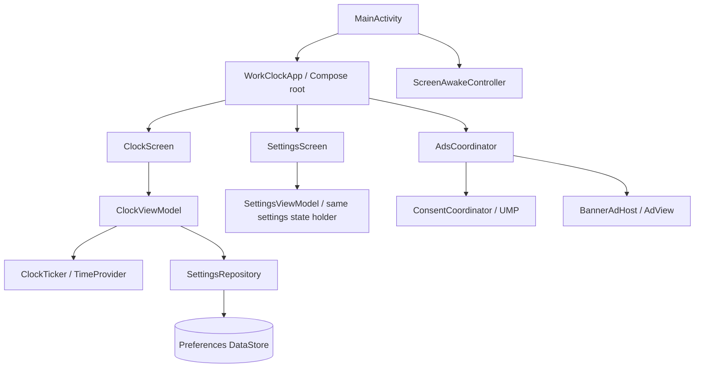

# WorkClock — Application Architecture

**Version:** 1.0  
**Date:** 12 November 2026  
**Architecture style:** Small native Android app; local-first; single app module

## 1. Architecture goals

- Render the clock independently of advertising and consent SDKs.
- Keep all clock functionality local.
- Keep the display awake only while the Activity is visible and feature-enabled.
- Store only small user preferences.
- Isolate AdMob/UMP integration so failures do not affect the clock.
- Avoid unnecessary modules, backend services and abstractions.
- Keep the code testable through injectable time/settings interfaces.

## 2. High-level context



The clock does not require the internet. The AdMob and UMP integrations do use network services when appropriate.

## 3. Runtime components



## 4. Package structure

Use a single app module with clear packages:

```text
<package>.workclock/
├── MainActivity.kt
├── WorkClockApp.kt
├── clock/
│   ├── ClockViewModel.kt
│   ├── ClockState.kt
│   ├── ClockTicker.kt
│   ├── TimeProvider.kt
│   └── TimeFormatter.kt
├── settings/
│   ├── ClockSettings.kt
│   ├── SettingsRepository.kt
│   ├── SettingsViewModel.kt
│   └── SettingsKeys.kt
├── ads/
│   ├── AdsCoordinator.kt
│   ├── ConsentCoordinator.kt
│   ├── BannerAdHost.kt
│   └── AdConfig.kt
├── display/
│   ├── ScreenAwakeController.kt
│   ├── BrightnessController.kt
│   └── SystemBarController.kt
├── ui/
│   ├── clock/ClockScreen.kt
│   ├── settings/SettingsScreen.kt
│   ├── controls/QuickControls.kt
│   ├── components/
│   └── theme/
└── util/
    └── WindowSize.kt
```

Do not create a `network`, `backend`, `repository` or `domain` module unless the project grows enough to justify it.

## 5. Component responsibilities

### MainActivity

- Owns the Android Window.
- Sets Compose content.
- Applies/clears `FLAG_KEEP_SCREEN_ON` according to visible state and user preference.
- Applies Activity-specific brightness override.
- Handles lifecycle events and system bars.
- Does not own clock formatting or ad business rules.

### WorkClockApp

- Hosts the app UI and theme.
- Reads the current app/navigation surface state.
- Does not block on network tasks.

### TimeProvider

- Returns `ZonedDateTime` or equivalent from the Android system clock.
- Uses the current device default time zone.
- Injectable for tests.

### ClockTicker

- Emits current time at second or minute boundaries based on settings.
- Re-reads the actual system clock each tick.
- Stops work when not visible/collected.
- Avoids a busy loop.

### ClockViewModel

- Combines current time and clock settings into UI state.
- Exposes state using `StateFlow`.
- Handles settings changes via repository or settings state holder.
- Refreshes current time when returning to foreground.

### SettingsRepository

- Reads/writes `ClockSettings` through Preferences DataStore.
- Validates values and provides safe defaults.
- Persists only user-selected preferences.

### ScreenAwakeController

- Applies `FLAG_KEEP_SCREEN_ON` when `isClockVisible && settings.keepScreenAwake`.
- Clears the flag when not required.
- Never uses background service or partial wake lock.

### BrightnessController

- Applies app-window brightness only.
- Restores system default when user chooses System or exits custom brightness mode.

### ConsentCoordinator

- Calls UMP consent update on app launch.
- Shows required consent form.
- Exposes whether ads can be requested and whether privacy options are required.
- Does not decide legal policy on its own; behaviour must follow the configured UMP and counsel-reviewed policy.

### AdsCoordinator

- Owns ad readiness and request policy.
- Never blocks clock rendering.
- Requests a banner only after UMP eligibility.
- Does not implement custom rapid refresh.
- Exposes state: `Disabled`, `WaitingForConsent`, `Loading`, `Loaded`, `NoFillOrError`.

### BannerAdHost

- Hosts one AdView in a dedicated bottom layout slot.
- Calculates adaptive size from current width.
- Integrates with Compose lifecycle using `AndroidView` or an official supported Compose wrapper.
- Disposes the AdView correctly.
- Cannot overlay the time or controls.

## 6. State model

### ClockSettings

```kotlin
enum class TimeFormat { SYSTEM, HOUR_12, HOUR_24 }
enum class BrightnessMode { SYSTEM, CUSTOM }
enum class OrientationMode { SYSTEM, PORTRAIT, LANDSCAPE }

data class ClockSettings(
    val timeFormat: TimeFormat = TimeFormat.SYSTEM,
    val showSeconds: Boolean = true,
    val showDate: Boolean = true,
    val keepScreenAwake: Boolean = true,
    val themeId: String = "midnight",
    val brightnessMode: BrightnessMode = BrightnessMode.SYSTEM,
    val brightnessLevel: Float = 0.6f,
    val orientationMode: OrientationMode = OrientationMode.SYSTEM,
    val immersiveMode: Boolean = false,
    val oledCareEnabled: Boolean = false
)
```

### ClockUiState

```kotlin
data class ClockUiState(
    val now: ZonedDateTime,
    val settings: ClockSettings,
    val controlsVisible: Boolean,
    val adState: AdState
)
```

The current time itself is never persisted. A new `now` is read on each resume.

## 7. Data flow

### Settings

`Settings UI event -> ViewModel -> SettingsRepository -> DataStore -> Flow<ClockSettings> -> ViewModel -> Compose UI`.

### Clock time

`ClockTicker -> TimeProvider.now() -> ClockViewModel StateFlow -> Compose text`.

### Keep-awake

`ClockUiState.settings.keepScreenAwake + Activity resumed -> ScreenAwakeController -> Activity Window flag`.

### Ads

`App launch -> ConsentCoordinator / UMP -> ads eligibility -> AdsCoordinator -> BannerAdHost -> AdMob SDK -> ad delivery`.

The banner is an optional side effect. The clock has no dependency on it.

## 8. Lifecycle rules

- Start the clock ticker while the clock screen is visible/started.
- Stop or suspend ticker work when the app is not visible.
- Read current system time immediately on resume.
- Apply keep-awake only while visible and enabled.
- Do not hold a wake lock after backgrounding.
- Pause/resume/destroy AdView according to the current Google SDK guidance.
- Do not call `loadAd()` on every Compose recomposition.
- Recreate or update adaptive banner dimensions only when the available width changes materially.

## 9. Time change handling

The displayed time must react to:

- User or network changes to system clock.
- Time-zone changes.
- Daylight-saving changes (where relevant).
- Date rollover.
- App returning from background.

Use dynamic receivers only while appropriate and unregister them correctly. Avoid registering a permanent background receiver/service. At minimum, each time render must query the system clock instead of incrementing the last displayed value.

## 10. Advertising isolation and failure containment

- Ads run in their own package and host view.
- A failure callback updates ad state only.
- Never throw an ad SDK error into the clock state or crash the Activity.
- Consent state is checked before every eligible ad request according to UMP docs.
- The banner's rectangle is measurable and testable; automated tests should assert it does not overlap the clock content.
- If Pro is added later, `AdsCoordinator` checks entitlement before creating/loading an AdView.

## 11. Offline behaviour

When offline:

- System time remains available locally.
- Clock refresh continues.
- Settings can be read and saved locally.
- No ad is expected.
- No WorkClock error screen appears.
- UMP/ad network failures are handled quietly while preserving the clock.

## 12. Security and privacy boundaries

- No server secrets exist in the app.
- AdMob App ID and ad-unit ID are public identifiers, not secrets.
- Do not collect location, contacts, media or other unrelated information.
- Review SDK manifest merging and data handling.
- Privacy disclosures must account for Google Mobile Ads SDK collection/sharing.
- Do not add a separate analytics SDK in v1.

## 13. Observability

Use:

- Android Studio Logcat in development.
- Unit/UI/instrumentation tests.
- Play Console Android vitals after release.
- AdMob reporting for ad requests, match rate, impressions and estimated earnings.
- Store reviews and direct support email.

Do not log personal data, ad identifiers, consent strings or raw purchase tokens.

## 14. Future extension points

### Pro purchase

Add a small `billing/` package only when needed. Use Google Play Billing to query and acknowledge one-time purchases. The app can remain serverless, but client-only entitlement handling has weaker tamper resistance than server-side token verification.

### Additional themes

Add theme definitions as local constants/resources. No backend or remote theme store needed.

### Multi-time-zone clock

Add a `ZoneId` preference only if demand justifies it. Do not add location permission; users should choose a time zone manually.

## 15. Architecture decisions (ADRs)

| ADR | Decision | Rationale |
|---|---|---|
| ADR-001 | Native Kotlin | Direct Android window/lifecycle integration; lower complexity than cross-platform for Android-only v1 |
| ADR-002 | Jetpack Compose | Responsive UI with current Android tooling |
| ADR-003 | Local-first/no backend | Core clock does not need remote state |
| ADR-004 | System clock as source of truth | Avoid API dependency and server costs |
| ADR-005 | Activity keep-screen-on flag | Official foreground mechanism; no service/wake lock |
| ADR-006 | AdMob anchored adaptive banner | Standard banner format; keep ad in separate bottom layout |
| ADR-007 | UMP for consent | Use official consent management integration where required |
| ADR-008 | One app module | Keep maintenance and build complexity low |

---

**Architecture rule:** If a feature requires introducing a server, permission, background service or large SDK, challenge that requirement before implementation. WorkClock's value is its small footprint.
