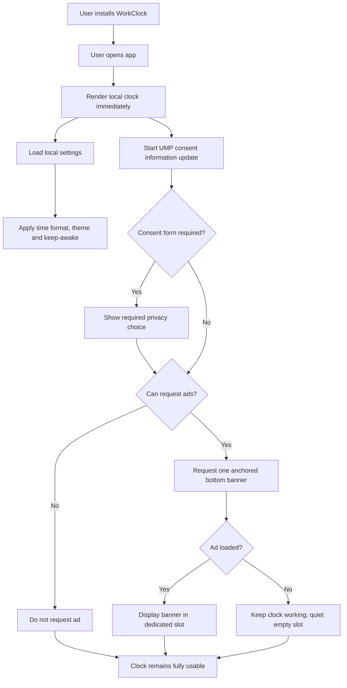
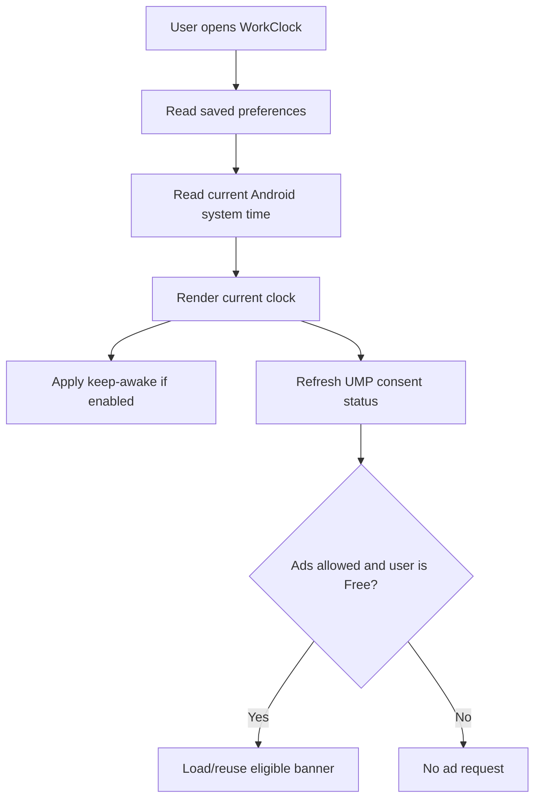
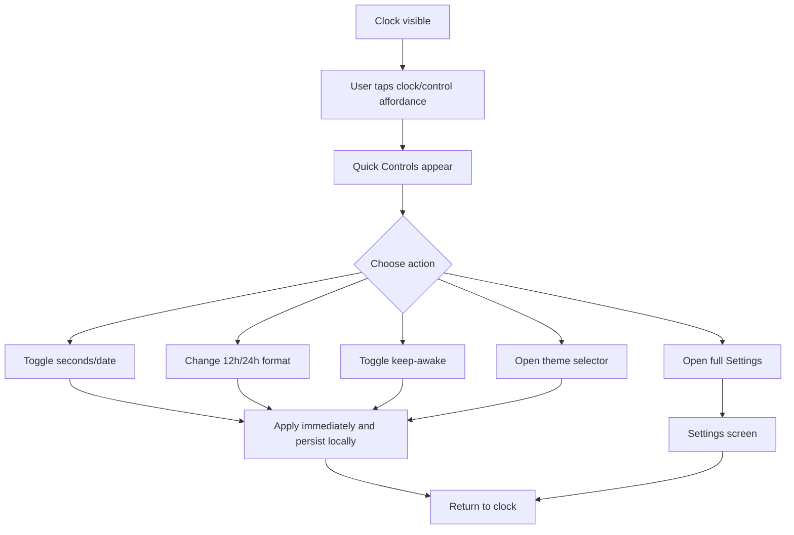
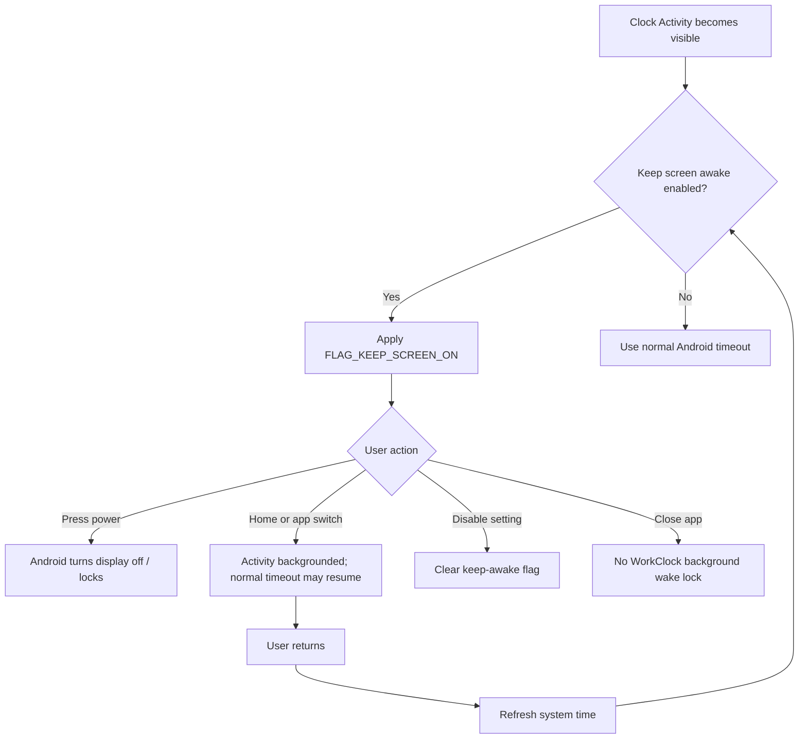
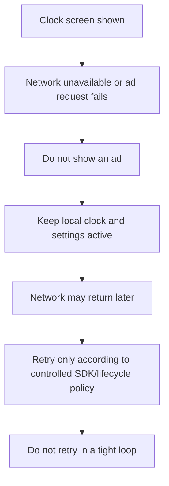
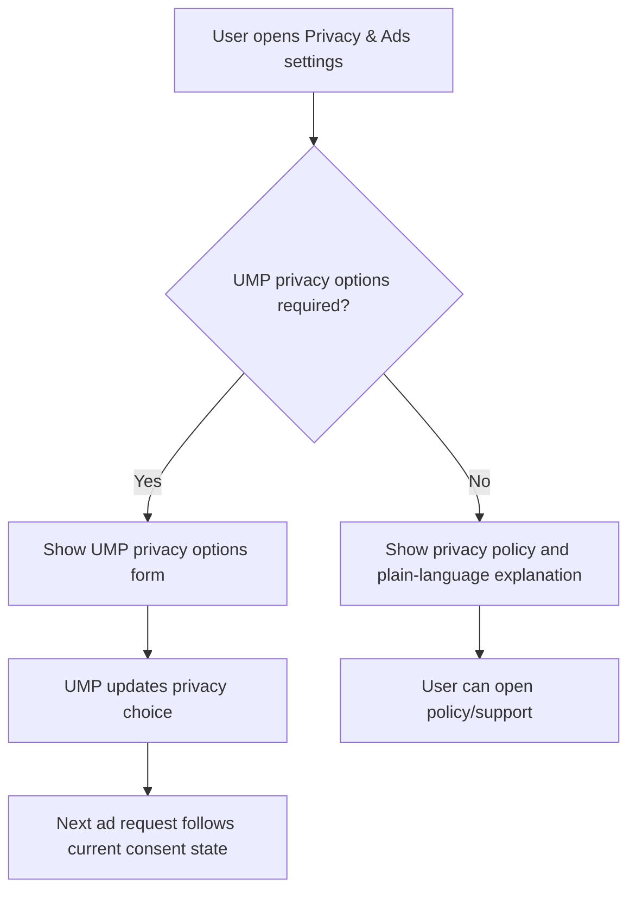
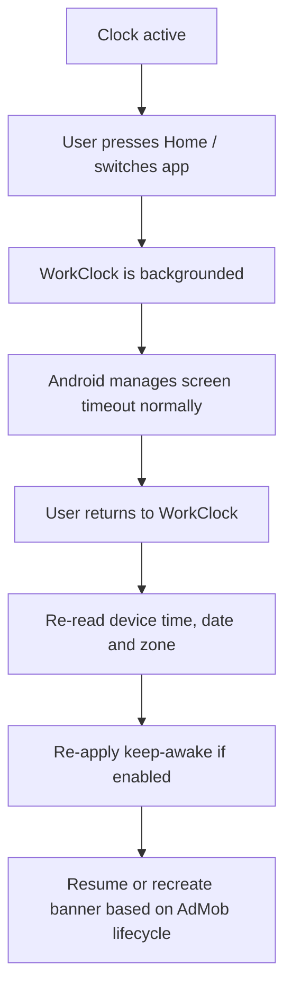
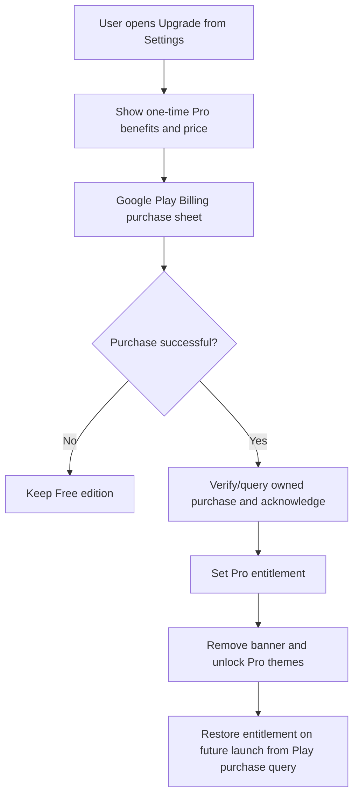

# WorkClock — User Flows

**Version:** 1.0  
**Date:** 12 November 2026

## 1. Primary flow — first launch

The clock is rendered before consent/ad networking. A legally required consent interaction may still be presented, but an advertisement must never block clock initialization.

## 2. Returning user flow

## 3. Clock controls flow

## 4. Screen-awake flow

## 5. Offline and ad-failure flow

## 6. Privacy choices flow

## 7. App background and return flow

## 8. Future Pro purchase flow (not v1.0)

## 9. Flow exceptions

- **No network:** do not make the clock wait; no ad appears.
- **UMP cannot update:** do not bypass a consent requirement. Follow current UMP/AdMob documented failure handling and keep the clock visible.
- **Ad SDK crashes or fails:** isolate the ad surface; primary clock must remain usable.
- **User declines personalised ads:** use the eligible ad-serving mode returned by UMP/AdMob, or do not request ads if no eligible mode exists.
- **User taps power button:** WorkClock must not try to wake the screen back up.
- **Device time changes while open:** re-read system time; never keep displaying a stale incremented counter.
- **Rotation / resizing:** preserve settings and recompute dimensions; avoid duplicate banner instances.
